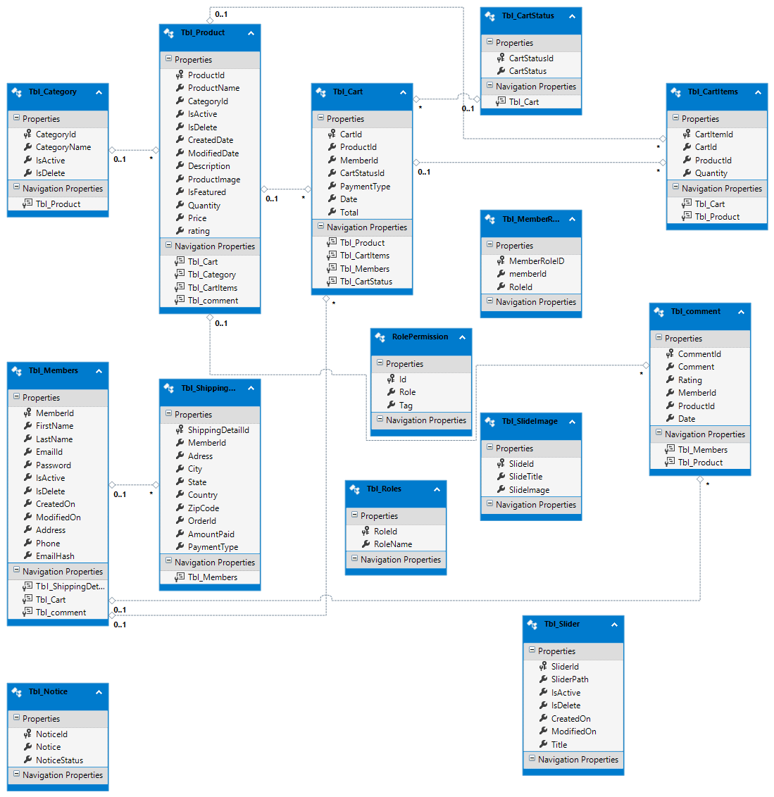

# 🤰 Mother Care - Emergency Maternity Health Platform

"Mother Care - For your Loved Ones" is a dedicated e-commerce solution addressing the critical need for maternity healthcare products during the pandemic. It provides a safe, accessible online marketplace for essential instruments and supplies when they are hardest to find.

> _Development Timeline: Delivered in just 13 days._

## 🛠 Tech Stack

| Frontend          | Backend          | Framework       |
| :---------------- | :--------------- | :-------------- |
| HTML5, CSS/SCSS   | C#               | **ASP.Net MVC** |
| Javascript (ES6+) | SQL (SQL Server) |                 |
| Bootstrap         |                  |                 |
| jQuery / AJAX     |                  |                 |

## ✨ Key Features

### 🔧 For Admins

- **Inventory Control**: Seamlessly add products, categories, and homepage slides.
- **Order Management**: Real-time status updates for customer orders.
- **Customization**: Full control over product listings and site-wide notices.

### 🛍 For Users

- **Specialized Shopping**: Access to a curated list of maternity products.
- **Dynamic Rating System**: Fully functional, dynamic feedback system for confirmed purchases.
- **Smart Search**: Filter products by category or quality ratings.
- **Secure Payments**: Integrated **PayPal** gateway for safe transactions.

## 📊 Database Design (ERD)

## 🎥 Project Demo

